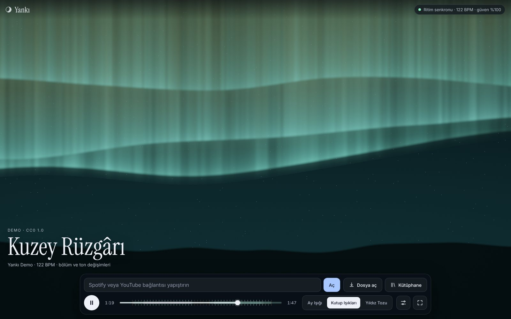

# Yankı

**An installable app (PWA) that turns music into a cinematic, interactive visual world.** Install it on phone, tablet or desktop; it opens full screen with its own icon and plays the demos offline. It analyzes your own audio files beat by beat and opens your Spotify and YouTube library in one place.

[Live demo](https://tahap0l.github.io/yanki/) · [Türkçe](README.md)



## Highlights

- **In-browser audio analysis (Web Worker).** Tempo (including variable tempo), individual beats, downbeats, bass/treble energy, onsets, silences and section boundaries. Local files never leave the device.
- **Confidence-aware sync.** Syncopated, accelerating or drumless passages are detected. When confidence is low the scene falls back to a soft energy response, and the user can fix beat alignment manually (offset, ½×/2× tempo, tap-to-align).
- **Playback-locked timeline.** Visuals follow the *audible* position (output latency compensated) and re-settle after pause, seek and tab switches. Measured median phase error: 1–7 ms.
- **Three WebGL 2 scenes** — Moonlight (ray-traced water with bass-driven ripples), Aurora (melody-driven curtains with section-aware palettes), Stardust (transform-feedback GPU particles steered by downbeats).
  - Canvas 2D fallback for limited GPUs.
  - An adaptive quality governor scales resolution and particle count to keep frame times stable.
- **Spotify and YouTube library.**
  - **Spotify:** PKCE OAuth, playlists, liked songs, recently played, search. Playback through the Web Playback SDK, falling back to Spotify Connect.
  - **YouTube:** Google Identity Services and the Data API, playing in the official, always-visible IFrame player.
  - **Rules:** in line with platform policies, neither Spotify nor YouTube audio is analyzed or used to sync visuals.

## Measured accuracy

The demo tracks were synthesized for this project, so ground-truth beat times are known.

| Track | Challenge | Beat F-measure (±70 ms) | Downbeat F |
|---|---|---|---|
| Gece Gölü | 88 BPM, drumless intro, syncopation | 1.00 | 1.00 |
| Kuzey Rüzgârı | 122 BPM, section and key changes | 0.95 | 0.96 |
| Toz Bulutu | 96→116 BPM accelerando, syncopation | 0.94 | 0.95 |

A random-onset (arrhythmic) signal gets a confidence of 0.09 and no downbeats.

## Stack

TypeScript, Vite, Web Audio API, Web Workers, WebGL 2 (GLSL ES 3.0, transform feedback, HDR trail buffer), Canvas 2D, IndexedDB. No runtime framework or audio library — the FFT, beat tracker, tempo Viterbi, downbeat HMM and novelty-based segmentation are implemented from scratch.

## Run

```bash
npm install
npm run dev     # http://127.0.0.1:5173
npm test        # analysis accuracy + link parser tests
```

See [docs/KURULUM.md](docs/KURULUM.md) for Spotify / Google setup (in Turkish).

## License

MIT © 2026 Esat Taha Polat. Demo audio CC0.
