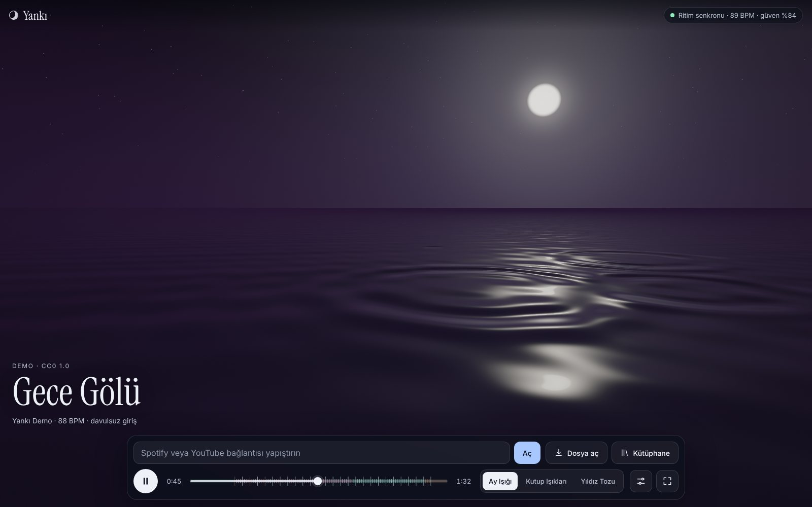
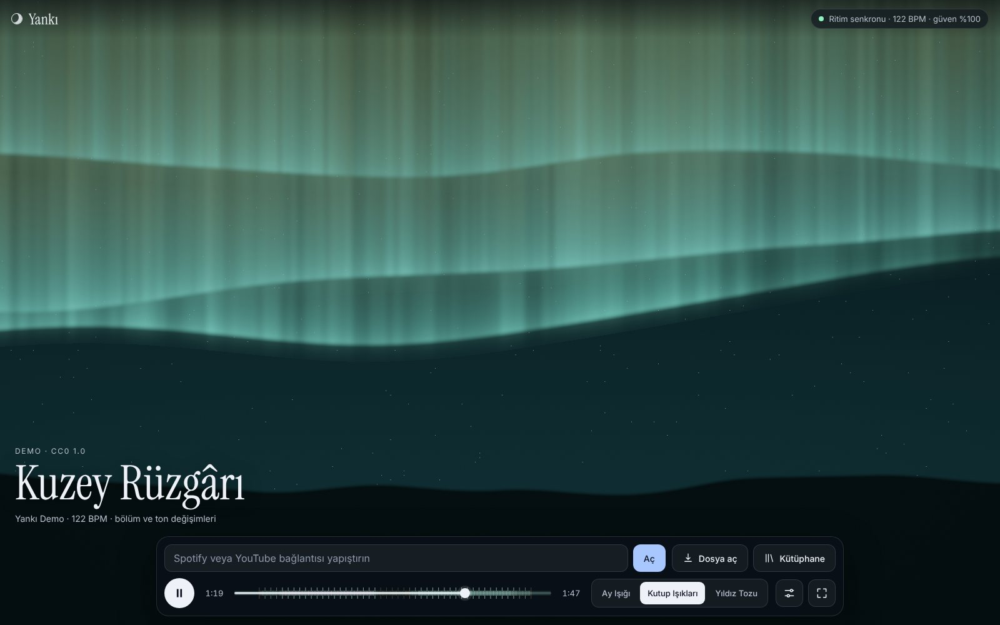
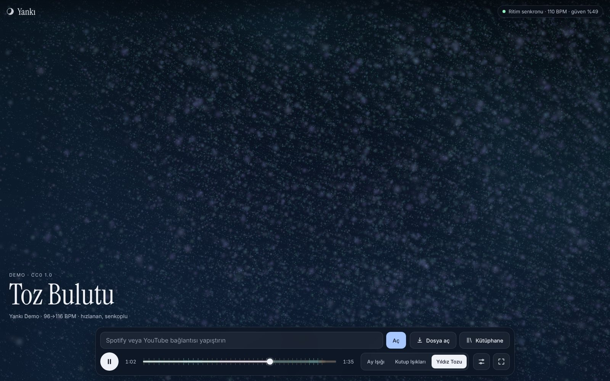
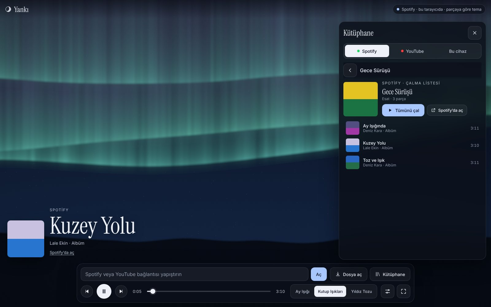
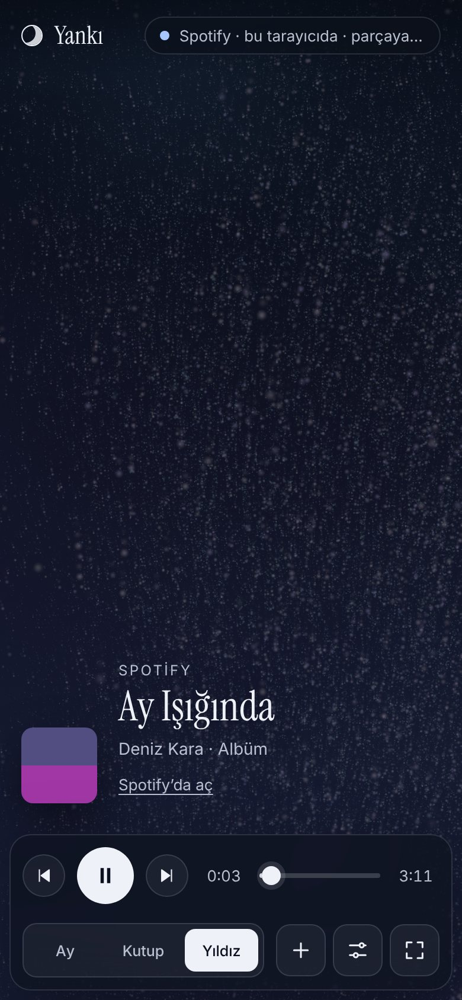
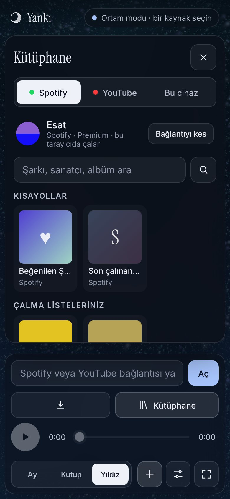
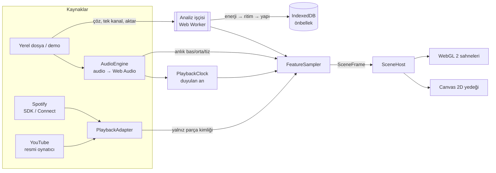

<div align="center">

# Yankı

**Müziği sinematik, etkileşimli bir görsel dünyaya dönüştüren uygulama.**

Telefona, iPad'e ve bilgisayara yüklenir; kendi simgesiyle tam ekran açılır, demolarla çevrimdışı da çalışır. Kendi ses dosyalarınızı vuruşu vuruşuna analiz eder; Spotify ve YouTube kütüphanenizi tek bir ekranda açar.

[**Canlı demo →**](https://tahap0l.github.io/yanki/) · [English](README.en.md) · [Kurulum](docs/KURULUM.md) · [Mimari](docs/MIMARI.md) · [Ses analizi](docs/SES-ANALIZI.md)




</div>

## İçindekiler

- [Uygulamayı yükle](#uygulamayı-yükle)
- [Neler yapar?](#neler-yapar)
- [Sahneler](#sahneler)
- [Kaynaklar: dosya, Spotify, YouTube](#kaynaklar-dosya-spotify-youtube)
- [Hızlı başlangıç](#hızlı-başlangıç)
- [Nasıl çalışır?](#nasıl-çalışır)
- [Ölçülen doğruluk](#ölçülen-doğruluk)
- [Klavye kısayolları](#klavye-kısayolları)
- [Proje yapısı](#proje-yapısı)
- [Test](#test)
- [Bilinen sınırlar](#bilinen-sınırlar)
- [Yol haritası](#yol-haritası)
- [Lisans](#lisans)

## Uygulamayı yükle

Yankı yüklenebilir bir uygulamadır (PWA): mağaza gerekmez, ana ekrana ya da bilgisayara kendi simgesiyle eklenir ve tarayıcı çubukları olmadan açılır.

| Cihaz | Nasıl |
|---|---|
| **iPhone / iPad** | [tahap0l.github.io/yanki](https://tahap0l.github.io/yanki/) adresini **Safari**'de açın → **Paylaş** → **Ana Ekrana Ekle** → **Ekle** |
| **Android** | Chrome'da açın → üstteki **Uygulamayı yükle** düğmesi (ya da ⋮ → **Uygulamayı yükle**) |
| **Windows / Mac / Linux** | Chrome ya da Edge'de açın → **Uygulamayı yükle** düğmesi ya da adres çubuğundaki yükle simgesi |

- **Çevrimdışı:** Yüklendikten sonra uygulama kabuğu ve bir kez çalınan demolar çevrimdışı çalışır.
- **Güncellemeler:** Yeni sürüm yayınlandığında üstte **Yenile** düğmesi çıkar.
- **Kısayollar:** Ana ekran simgesine uzun basınca “Kütüphane” ve “Demo parçalar” kısayolları görünür.

## Neler yapar?

- **Gerçek ses analizi, tarayıcıda.** Yerel bir dosyayı açtığınızda; tempo, tek tek vuruşlar, ölçü başları, bas/tiz enerjisi, ataklar, sessizlikler ve bölüm geçişleri bir Web Worker'da çıkarılır. Dosya hiçbir yere yüklenmez.
- **Değişken tempo ve güven skoru.** Hızlanan, senkoplu ya da davulsuz başlayan parçalarda algoritma ne kadar emin olduğunu bilir; emin değilse sahne yumuşak enerji tepkisine geçer, siz de vuruş hizasını elle düzeltebilirsiniz.
- **Oynatıcıya kilitli zaman çizelgesi.** Görseller hoparlörden duyulan ana göre çizilir; duraklatma, ileri sarma ve sekmeye dönüşte doğru konuma yeniden oturur. Ölçülen ortanca faz hatası 1–7 ms.
- **Üç sinematik sahne**, WebGL 2 ile; GPU'su sınırlı cihazlar için Canvas 2D görünümü. Kare süresine göre çözünürlük ve parçacık sayısı kendiliğinden uyarlanır.
- **Spotify ve YouTube kütüphanesi.** Hesabınızı bağlayın; listelerinize, beğendiklerinize, son çaldıklarınıza ve aramaya buradan ulaşıp şarkıyı bu ekrandan başlatın.
- **Erişilebilir ve sakin.** Klavye ve dokunmayla tam kullanım, görsel yoğunluk ve azaltılmış hareket ayarları; sert beyaz flaş yok.

## Sahneler

| | |
|---|---|
|  | **Ay Işığı** — Işın izlemeli bir su yüzeyi. Bas vuruşları suda genişleyip sönen halkalar açar; ince sesler ay yolunun yansımasını titretir. |
|  | **Kutup Işıkları** — Katmanlı ışık perdeleri. Melodi ve tizler şeritleri kıvırır, ışınları titreştirir; güvenilir bölüm geçişlerinde renk paleti yavaşça dönüşür. |
|  | **Yıldız Tozu** — GPU'da güncellenen on binlerce parçacık. Ölçü başları akışın yönünü değiştirir; parçanın enerjisi sahnenin derinliğini ve yoğunluğunu belirler. |

Hareketler yumuşak başlar ve sönümlenir. Ayrıntılar: [docs/SAHNELER.md](docs/SAHNELER.md).

## Kaynaklar: dosya, Spotify, YouTube



| Kaynak | Nerede çalar | Görsel |
|---|---|---|
| **Yerel dosya** (MP3, M4A, WAV, FLAC, OGG…) | Uygulamada | Tam ritim senkronu |
| **Demo parçalar** (özgün, CC0) | Uygulamada | Tam ritim senkronu |
| **Spotify hesabı** | Bu tarayıcıda (Web Playback SDK, Premium) ya da açık Spotify uygulamanızda (Connect) | Parçaya göre renk teması; hareket kendi zamanında |
| **YouTube hesabı** | Resmi, her zaman görünür YouTube oynatıcısında | Parçaya göre renk teması; hareket kendi zamanında |

Platform kuralları gereği Spotify ve YouTube sesi analiz edilmez, yakalanmaz, kaydedilmez; görseller bu sese senkronlanmaz. Kurulum ve platform sınırları: [docs/KURULUM.md](docs/KURULUM.md).

<p align="center">
  
  
</p>

> Kütüphane ekran görüntüleri test verisiyle (sahte hesap ve parça adları) alınmıştır.

## Hızlı başlangıç

Gereksinim: Node.js 20+.

```bash
git clone https://github.com/tahap0l/yanki.git
cd yanki
npm install
npm run dev          # http://127.0.0.1:5173
```

| Komut | Ne yapar |
|---|---|
| `npm run dev` | Geliştirme sunucusu (127.0.0.1 — Spotify `localhost` kabul etmez) |
| `npm run build` | Tür denetimi + üretim derlemesi → `dist/` |
| `npm run preview` | Derlemeyi yerelde sunar |
| `npm test` | Ses analizi doğruluk testi + bağlantı ayrıştırıcı testleri |
| `npm run test:browser` | Gerçek Chrome'da senkron, sarma, önbellek, tam ekran testleri |
| `npm run test:services` | Spotify / Google / YouTube akışları, sahte servislerle |
| `npm run demos` | Demo parçaları yeniden sentezler (ffmpeg gerekir) |

Spotify ve YouTube için geliştirici uygulama kimlikleri gerekir; `.env.example` dosyasını `.env` olarak kopyalayıp doldurun ya da uygulamadaki Kütüphane panelinden girin. Adım adım anlatım: [docs/KURULUM.md](docs/KURULUM.md).

### Yayınlama

Depo, `main` dalına her gönderimde derleyip `gh-pages` dalına yayın yapan bir iş akışı içerir (`.github/workflows/deploy.yml`). Pages kaynağı **Settings › Pages › Deploy from a branch › `gh-pages` / (root)** olmalıdır. Spotify/Google kimliklerini **Settings › Secrets and variables › Actions › Variables** altında `SPOTIFY_CLIENT_ID` ve `GOOGLE_CLIENT_ID` olarak tanımlayabilirsiniz (gizli değildir).

## Nasıl çalışır?



- **Ses kaynağı, analiz, oynatma zamanı ve sahne çizimi ayrı bileşenlerdir.** Sahneler yalnız `SceneFrame` arayüzünü bilir; kaynağın dosya mı Spotify mı olduğundan habersizdir.
- **Analiz aşamalı gelir:** önce enerji eğrileri, sonra ritim, en son bölümler. Oynatma hemen başlar, sahne her aşamayla iyileşir.
- **Parça değişince** önceki işçi sonlandırılır; eski parçanın sonuçları yeni parçaya asla uygulanmaz.
- **Aynı dosya** yeniden açıldığında analiz cihazdaki önbellekten gelir (dosya adından bağımsız parmak iziyle).

Ayrıntılar: [docs/MIMARI.md](docs/MIMARI.md) · [docs/SES-ANALIZI.md](docs/SES-ANALIZI.md)

## Ölçülen doğruluk

Demo parçalar bu proje için sentezlendiğinden gerçek vuruş zamanları bilinir (`test/truth/`). `npm test` her parçayı tarayıcıdaki yolla aynı biçimde (MP3 → 22 050 Hz, tek kanal) analiz edip karşılaştırır.

| Parça | Zorluk | Vuruş F-ölçüsü (±70 ms) | Ölçü başı | Bölüm sınırı (±2 sn) |
|---|---|---|---|---|
| Gece Gölü | 88 BPM, 16 sn davulsuz giriş, senkoplu | **1,00** | 1,00 | 0,80 |
| Kuzey Rüzgârı | 122 BPM, bölüm ve ton değişimi | **0,95** | 0,96 | 1,00 |
| Toz Bulutu | 96→116 BPM hızlanan, senkoplu | **0,94** | 0,95 | 0,80 |
| Gece Gölü, %125 hızlandırılmış | | 0,99 | | |
| Gürültü + 3 sn gecikme + −12 dB | | 0,95 | | |

- **Ritimsiz sinyal:** rastgele zamanlı ataklarda güven skoru **0,09** çıkar ve ölçü başı üretilmez.
- **Güvenilir vuruşlar:** güveni ≥ 0,5 olan vuruşların isabeti tüm demolarda 1,00.
- **Uzun dosya:** 30 dakikalık parça yaklaşık 4 saniyede analiz edilir, ek bellek ~13 MB.

## Klavye kısayolları

| Tuş | İşlev |
|---|---|
| `Boşluk` / `K` | Oynat / duraklat |
| `←` `→` | 5 saniye geri / ileri |
| `1` `2` `3` | Ay Işığı / Kutup Işıkları / Yıldız Tozu |
| `F` | Tam ekran |
| `[` `]` | Vuruş hizasını 10 ms kaydır |
| `T` | Ritme dokun (hizayı dokunarak ayarla) |
| `Esc` | Paneli kapat |

Tam ekranda kontroller hareketsizlikte gizlenir, fare, dokunma ya da klavyeyle belirir ve klavye odağı içerideyken görünür kalır.

## Proje yapısı

```
src/
├─ analysis/     STFT, akış, tempo, vuruş, ölçü başı, bölüm; Worker; önbellek
├─ audio/        AudioEngine — oynatma + anlık frekans analizi
├─ playback/     PlaybackClock — görsel zamanı oynatıcıya bağlar
├─ sync/         FeatureSampler — analiz + konum → SceneFrame
├─ scenes/       SceneHost, kalite uyarlama, webgl/ ve canvas2d/ sahneleri
├─ services/     Spotify (PKCE, Web API, SDK) ve YouTube (GIS, Data API)
├─ sources/      bağlantı ayrıştırıcı, lisanslı katalog, YouTube oynatıcısı
└─ app/          App (arayüz), Library (kütüphane paneli), BeatStrip, tercihler
test/            analiz doğruluğu, tarayıcı ve servis testleri, sahte SDK'lar
scripts/         demo sentezleyici, simge kaynakları, service worker şablonu ve derleme eklentisi
docs/            ayrıntılı belgeler ve ekran görüntüleri
```

## Test

| Test | Kapsam |
|---|---|
| `test/eval.ts` | FFT doğruluğu; 3 demo + hızlandırma + gürültü + ritimsiz sinyal + 30 dk dosya |
| `test/links.ts` | Spotify/YouTube bağlantı biçimleri, katalog hak doğrulaması |
| `test/browser_full.py` | Gerçek Chrome: senkron fazı, sarma, duraklatma, sekme dönüşü, iptal, elle hiza, önbellek, tam ekran |
| `test/services.py` | OAuth PKCE, belirteç yenileme, Spotify API (Şubat 2026 biçimi), SDK ve Connect, YouTube; hata durumları |
| `test/pwa.py` | Service worker, çevrimdışı açılış, önbellekten demo çalma ve sarma, iOS yükleme yardımı, yüklüyken gizlenen düğme |

Ayrıntılı sonuçlar: [docs/TEST.md](docs/TEST.md)

## Bilinen sınırlar

- **Spotify:** geliştirme modundaki bir uygulama sahibinin Premium üyeliğini ister ve en fazla 5 izinli kullanıcıya açıktır. Herkese açık kullanım Spotify tarafından yalnız büyük, tescilli kuruluşlara veriliyor. Başkasına ait listelerin içeriği gösterilemez (bütün olarak çalınabilir).
- **YouTube Music:** “Beğenilen müzikler” listesine resmi API erişimi yoktur; YouTube'da beğenilen videolar ve listeler görünür.
- **Spotify ve YouTube akışları** gerçek hesaplarla değil, sahte servislerle uçtan uca test edildi.
- **Gerçek cihaz:** testler başsız Chrome'da (yazılımsal GPU, telefon/iPad görünüm benzetimi) yapıldı; Safari ve gerçek mobil GPU'da ayrıca doğrulanmalı.
- **Uzun dosyalar:** tam analiz masaüstünde 30, mobilde 15 dakikayla sınırlı; daha uzun dosyalar anlık enerjiyle görselleştirilir.

## Yol haritası

- [ ] Gerçek iPhone, iPad ve Android cihazlarda kare süresi ve gecikme ölçümü
- [ ] Albüm kapağından türetilen renk paleti (platform kurallarına uygunluk incelemesiyle)
- [x] Yüklenebilir uygulama (PWA): ana ekrana ekleme, çevrimdışı demo
- [ ] Mağaza paketleri (App Store / Play Store, Windows / Mac)
- [ ] Dördüncü sahne ve sahne başına özelleştirme

## Lisans

Kod [MIT](LICENSE) lisanslıdır. Demo sesler bu proje için sentezlendi ve kamu malıdır (CC0 1.0). Yazı tipleri SIL Open Font License 1.1 kapsamındadır.

---

<p align="center">Esat Taha Polat · <a href="https://github.com/tahap0l">@tahap0l</a> · <a href="https://tahap0l.github.io">tahap0l.github.io</a></p>
