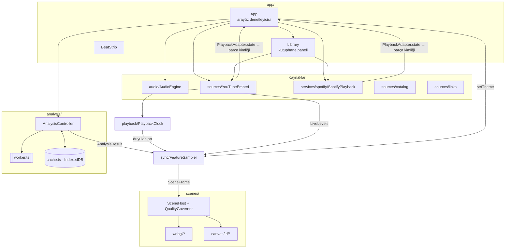
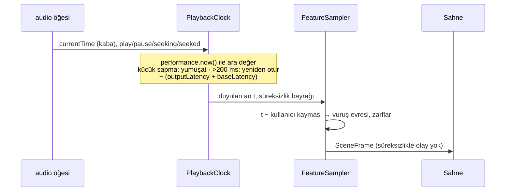
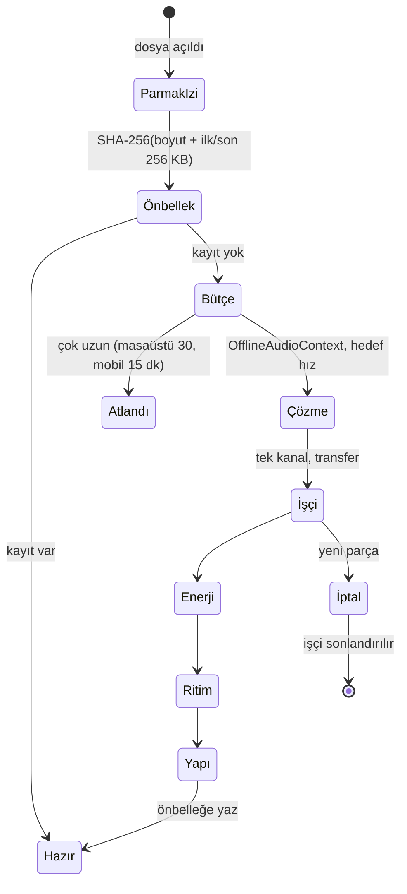

# Mimari

Yankı tek sayfalık, sunucusuz bir TypeScript uygulamasıdır. Tasarımın ana kuralı şudur: **ses kaynağı, analiz, oynatma zamanı ve sahne çizimi birbirinden ayrı bileşenlerdir** ve yalnız küçük arayüzlerle konuşur.

## Bileşenler

| Bileşen | Sorumluluk | Bilmedikleri |
|---|---|---|
| `AudioEngine` | `<audio>` → `MediaElementSource` → `AnalyserNode` → çıkış. Anlık bas, orta, tiz ve RMS; iOS ses oturumu. | Analiz, sahne |
| `AnalysisController` | Dosyayı çözer, tek kanala indirir, işçiye **aktarır**; aşamalı sonuçları iletir; önbellek; iptal. | Oynatma, sahne |
| `worker.ts` / `analyze.ts` | Saf hesap: öznitelik, ritim, yapı. DOM yok; Node'da da çalışır (testler bunu kullanır). | Tarayıcı API'leri |
| `PlaybackClock` | Oynatıcının gerçek konumu → duyulan an; süreksizlik bildirimi. | Analiz |
| `FeatureSampler` | Analiz + konum + anlık seviye + kullanıcı hizası → `SceneFrame`. Güven düşükse yumuşak enerji moduna geçer. Akış kaynaklarında ortam modu ve parça teması. | Kaynak türü, çizim |
| `SceneHost` | WebGL 2 / Canvas 2D seçimi, bağlam kaybı, yeniden boyutlama, kalite uyarlama. | Müzik |
| Sahneler | Yalnız `SceneFrame` okur ve çizer. | Her şey |
| `PlaybackAdapter` | Spotify ve YouTube için ortak denetim: `toggle`, `next`, `prev`, `seek`, `state`. | Sahne |

## SceneFrame

Sahnelerin tek girdisidir (`src/scenes/types.ts`):

- **Enerji:** yumuşatılmış `bass`, `mid`, `treble`, `energy` ve `melody` (spektral merkez).
- **Ritim:** `beatPhase`; yumuşak zarflı `beatPulse`, `barPulse`, `onsetPulse`.
- **Olaylar:** bu karede geçilen `beats[]`, `downbeat` ve `onsets[]`. Sarma ve sekme dönüşünde boştur.
- **Mod:** `sync` (0..1, vuruş senkronunun ağırlığı) ve `mode`: `beat` | `energy` | `ambient`.
- **Görünüm:** palet geçişi (`paletteFrom`, `paletteTo`, `paletteMix`), `sectionEnergy` ve sessizlikte `hush`.
- **Kullanıcı ayarları:** `intensity` ve `reducedMotion`.

Böylece yeni bir sahne eklemek yalnız `SceneRenderer` arayüzünü uygulamaktır; yeni bir kaynak eklemek de yalnız `PlaybackAdapter` ya da analiz girdisi sağlamaktır.

## Zaman ve senkron

- **Ara değer:** `currentTime` bazı tarayıcılarda kaba güncellenir; saat bunu `performance.now()` ile ara değerler, tek yönlü ilerletir ve titremeyi bastırır.
- **Duyulan an:** `outputLatency + baseLatency` çıkarılarak görsel, hoparlörden duyulan ana hizalanır.
- **Süreksizlik:** `seeking`, `seeked`, `play`, `pause`, `ratechange`, `visibilitychange` ve `pageshow` olaylarında saat yeniden oturur ve o kare olay üretmez.
- **Öngörü:** vuruş darbeleri 35 ms öngörüyle yumuşak atakla başlar (algısal olarak tam vuruşta tepe yapar) ve üstel söner.

## Analizin yaşam döngüsü

- **Örnekleme hızı:** ≤ 12 dakika için 22 050 Hz, ≤ 20 dakika için 16 000 Hz, daha uzunsa 11 025 Hz.
- **Önbellek:** IndexedDB'de en çok 40 kayıt tutulur; en eski kullanılan silinir. Kullanıcının vuruş hizası düzeltmesi de parça başına saklanır.
- **Eski sonuçlara karşı iki katman:**
  1. Her iş bir kimlik taşır; kimliği eşleşmeyen işçi mesajları yok sayılır.
  2. `App`, gelen sonucun kaynak anahtarı şu anki kaynağınkiyle eşleşmiyorsa onu uygulamaz.

## Sahne çizim hattı

`SceneHost` her karede `rAF` aralığını ölçer ve ekran yenileme hızını (60/90/120 Hz) tahmin eder. `QualityGovernor` 7 kademede çözünürlük ve parçacık sayısını uyarlar:

| Kademe | Çözünürlük | Parçacık |
|---|---|---|
| 0 | %100 | %100 |
| 1 | %85 | %75 |
| 2 (mobil başlangıç) | %70 | %55 |
| 3 | %58 | %40 |
| 4 | %47 | %28 |
| 5 | %38 | %18 |
| 6 | %30 | %12 |

- **Kademe düşürme:** kare süresinin üstel ortalaması bütçenin %35 üstünde 0,9 sn kalırsa.
- **Kademe yükseltme:** ortalama bütçenin %8 altında 6 sn kalırsa.
- **Bekleme:** her değişiklikten sonra 2,5 sn beklenir.
- **Sabitleme:** `?quality=0..6` ile kademe sabitlenebilir (tanılama).

WebGL 2 bağlamı oluşturulamazsa ya da sahne derlenemezse Canvas 2D görünümüne geçilir ve kullanıcıya bildirilir. Bağlam kaybında sahne, bağlam geri gelince yeniden kurulur.

## Akış kaynakları

Spotify ve YouTube aynı `PlaybackAdapter` arayüzünü uygular; taşıma çubuğu, kilit ekranı (Media Session, yalnız Spotify) ve klavye kısayolları bu arayüz üzerinden çalışır.

| | Spotify | YouTube |
|---|---|---|
| Kimlik doğrulama | Authorization Code + PKCE (S256), belirteç yenileme | Google Identity Services belirteç istemcisi, sessiz yenileme |
| Belirteç | `localStorage` (bu cihaz) | `sessionStorage` (bu oturum) |
| Çalma | Web Playback SDK (bu tarayıcı), yoksa Connect | Resmi IFrame oynatıcısı |
| Durum | SDK olayları ya da 2,5 sn'de bir `/me/player` | Oynatıcı API'si |
| Görsel | Ortam modu + parça kimliğinden tema | Ortam modu + parça kimliğinden tema |

Mobil tarayıcılarda ses ancak kullanıcı hareketiyle açılabildiği için Spotify oynatıcısı, kütüphane açılırken önceden hazırlanır. Böylece ilk dokunuşta `activateElement()` çağrılabilir.

## Canlı dinleme

`src/live/MicInput.ts` iki kaynaktan ses alır:

| Kaynak | Yöntem |
|---|---|
| Mikrofon | `getUserMedia`; yankı giderme, gürültü bastırma ve otomatik kazanç kapalı (cihazın kendi çaldığı müzik silinmesin) |
| Bilgisayarın sesi | `getDisplayMedia` + `systemAudio: 'include'`; görüntü izi alınır alınmaz durdurulur. Yalnız masaüstü Chromium'da sunulur. |

Ses çıkışa bağlanmaz, bu yüzden yankı oluşmaz.

Analiz `src/live/live-worklet.ts` içinde, **ses iş parçacığında** yapılır: her 768 örnekte (48 kHz'de ≈16 ms) Blackman pencereli 2048 noktalı spektrum, çizim kare hızından bağımsız olarak ana iş parçacığına gönderilir.

- **Saat eşleme:** Ses saati performans saatine, en küçük mesaj gecikmesi gözlemiyle eşlenir.
- **Yedek yol:** AudioWorklet yoksa her çizim karesinde `AnalyserNode` kullanılır.

| Aşama | Yöntem |
|---|---|
| Akış | 24 log bant, SuperFlux benzeri pozitif fark; kare süresine göre normalize; pencere gecikmesi kadar geriye zaman damgası |
| Zarf | Düzensiz rAF kareleri 100 Hz'lik düzenli halka arabelleğe (8 sn) yazılır |
| Tempo | Her 0,25 sn: otokorelasyon + metrik tarak + log-normal önsel + ölçü tutarlılığı (senkop düzeltmesi) + önceki tempoya süreklilik; 5 tahminin medyanı |
| Evre | Son 4 sn'de ızgaraya düşen zarfı en büyükleyen kayma |
| Izgara | Küçük farklar yumuşakça izlenir; büyük tempo/evre farkı ancak üst üste 3–4 tahminde doğrulanınca kabul edilir (sıçrama yok) |
| Güven | Periyodiklik × evre karşıtlığı × kararlılık, ya da ölçü kanıtı; ilk ~7 sn temkinli |
| Ölçü başı | Vuruşların 4'lü konumlarında bas atağı birikimi |
| Bölüm | 4 sn ve 16 sn tını ortalamalarının uzaklaşması (en az 16 sn arayla) |
| Seviye | Bant başına kayan tepe referansıyla otomatik kazanç; sessizlik algısı (kulaklık) |

`FeatureSampler.updateLive`, tahmin edilen ızgarayı giriş gecikmesi (`baseLatency` + izleme gecikmesi) ve kullanıcının kayma ayarı kadar öne alarak `SceneFrame` üretir. Ses yoksa ortam akışına döner. Yerel dosya çalarken dosyanın önceden yapılmış analizi önceliklidir.

**Ölçüm** (`test/live.ts`, ısınma sonrası; vuruş F ±70 ms):

| Parça | Ses iş parçacığı (`MODE=worklet`) | Çizim karesi yedeği (60 Hz, titreşimli) |
|---|---|---|
| Gece Gölü | 0,82 | 0,87 |
| Kuzey Rüzgârı | 0,85 | 0,88 |
| Toz Bulutu (hızlanan) | 0,96 | 0,95 |
| Kuzey Rüzgârı, düşük seviye + gürültü | 0,87 | 0,81 |
| Rastgele ataklar (ortalama güven) | 0,02 | 0,13 |

Ortanca vuruş hatası her iki yolda ±10 ms içindedir.

**Tarayıcı ölçümü** (`test/system_audio.py`, başka bir oynatıcıda çalan 122 BPM'lik parça, yazılımsal GPU ile çok düşük kare hızında): “Sistem sesi · 122 BPM · güven %99”.

Hatalar çoğunlukla bölüm geçişlerinde, izleyicinin yeni desene uyum sağladığı birkaç vuruşta oluşur.

## Yüklenebilir uygulama (PWA)

- **Manifest:** `public/manifest.webmanifest`. Bağımsız pencere (`standalone`, olanaklıysa `fullscreen`), maskelenebilir simge, ekran görüntüleri ve “Kütüphane / Demo parçalar” kısayolları.
- **Service worker:** `scripts/pwa-plugin.ts`, derleme sonunda `scripts/sw-template.js`'ten `dist/sw.js` üretir. Önbelleğe alma listesi derlenen kabuk dosyalarından oluşur; sürüm, bu dosyaların ve şablonun içerik özetidir.
- **Önbellek stratejisi:**

| İstek | Strateji |
|---|---|
| Sayfa gezintisi | Önce ağ (Spotify'ın OAuth dönüşü bozulmasın), çevrimdışıysa kabuk |
| JS, CSS, yazı tipleri, simgeler | Önbellek, yoksa ağ (`ignoreVary`: modül betikleri CORS kipinde istenir) |
| `catalog.json` | Önce ağ, çevrimdışıysa önbellek |
| Demo sesler | İlk çalışta önbelleğe; `Range` istekleri tam yanıttan 206 ile karşılanır (sarma çalışır) |
| Spotify, Google, YouTube | Hiç dokunulmaz |

- **Güncelleme:** Yeni service worker beklemeye geçince “Yenile” çubuğu gösterilir; dokunulunca `skipWaiting` → `controllerchange` → yeniden yükleme. Açık uygulama saatte bir güncelleme denetler.
- **Yükleme düğmesi:** Chrome, Edge ve Android'de `beforeinstallprompt` ile sistem istemi açılır; iOS'ta Safari adımları gösterilir. Uygulama yüklü açıldığında (`display-mode: standalone`) düğme gizlenir.

## Güvenlik

- **İçerik güvenlik politikası:** Yalnız gereken kaynaklara izin verilir; dize değerlendirmesi (`eval`) yasaktır.
  - Betik: `self`, YouTube, Spotify SDK, Google GIS.
  - Çerçeve: YouTube, Spotify SDK, Google.
  - Bağlantı: Spotify API ve hesapları, Google API'leri.
- **Dış veri:** Spotify ve YouTube'dan gelen metinler DOM'a yalnız `textContent` ile yazılır; HTML olarak işlenmez.
- **Gizlilik:** Ayrıntılar [GIZLILIK.md](GIZLILIK.md) belgesinde.
